  

  

### `~$ whoami`

Computer science at **Franciscan University of Steubenville**, class of 2029.
Offensive security, low level systems, random hardware hacking and the occasional
reverse engineering project.

  

### `~$ ps aux | grep building`

| project | what it does | stack |
| :--- | :--- | :--- |
| **[backquest](https://github.com/KieranK07/backquest)** | Gives an internet-less Windows PC internet through a Quest 3's WiFi, over the USB-C cable it was already charging on. gnirehtet with the roles swapped. | Rust · wintun · adb |
| **[Nexus](https://github.com/KieranK07/Nexus)** | Self-hosted single-user life dashboard: passkey login, Gmail, calendar, net worth, smart home, a PTY in the browser. | Go · React · WebAuthn |
| **[notables](https://github.com/KieranK07/notables)** | Records a lecture on the Mac, transcribes it with whisper large-v3 on a Windows GPU over Tailscale, and has Claude file the note into a Markdown vault. | Swift · Node · whisper |
| **[class-royale](https://github.com/KieranK07/class-royale)** | Degree planner for Franciscan University, built on the scraped catalog plus a student's own transcript. No server ever holds a login, a small browser extension does the one privileged fetch. | Next.js · TypeScript |
| **[KieranK07.github.io](https://github.com/KieranK07/KieranK07.github.io)** | Source for chadnerd.lol: two static pages, a Three.js ambient scene, no build step, on GitHub Pages. | HTML · Tailwind · Three.js |

  

### `~$ cat contact`

`site`     → **[chadnerd.lol](https://chadnerd.lol)**
 
`linkedin` → **[kieran-kelly07](https://www.linkedin.com/in/kieran-kelly07/)**
 
`discord`  → **[kieron.exe](https://discord.com/users/788394648494276628)**

  

  

